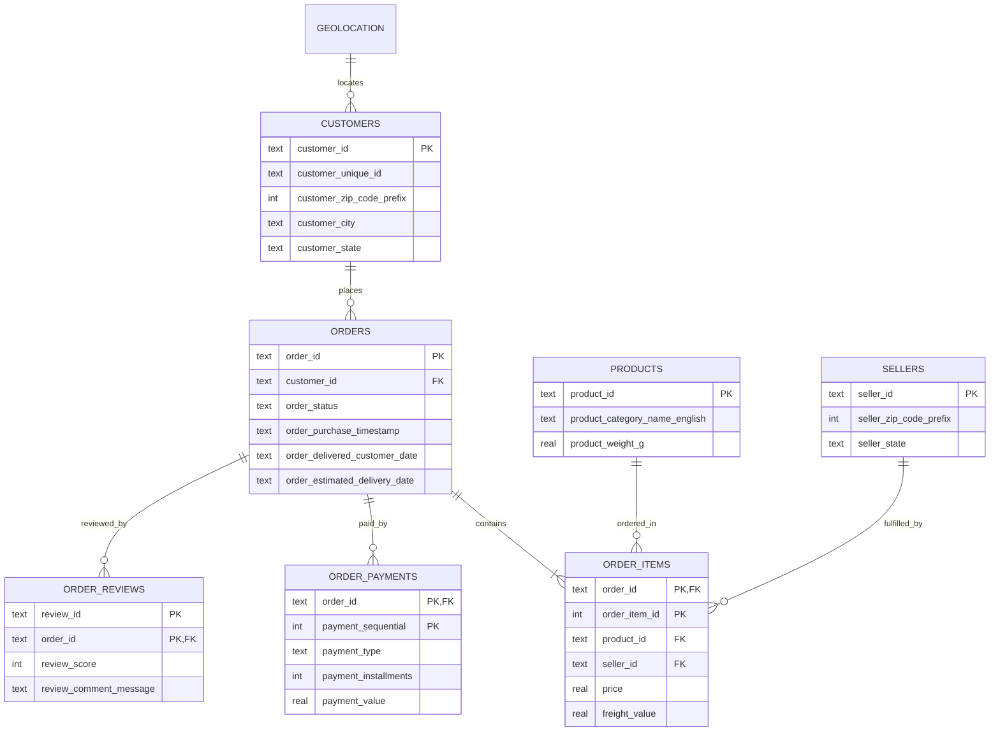

# 🛍️ Olist Brazilian E-Commerce Data Analytics & BI Platform

[](https://www.python.org/)
[](https://www.sqlite.org/)
[](https://streamlit.io/)
[](https://www.kaggle.com/datasets/olistbr/brazilian-ecommerce)
[](https://docs.pytest.org/)

Brezilya'nın en büyük e-ticaret pazar yerlerinden biri olan **Olist** platformunun (2016-2018 yılları arası, 100k'ya yakın sipariş) uçtan uca veri analitiği, ilişkisel veritabanı modellemesi, SQL iş sorguları, müşteri RFM segmentasyonu, lojistik SLA denetimi ve interaktif Streamlit iş zekası (BI) platformudur.

---

## 📌 İçindekiler
- [1. Proje Amacı ve İş Problemi](#1-proje-amacı-ve-iş-problemi)
- [2. Veritabanı Mimarisi & Şema (ERD)](#2-veritabanı-mimarisi--şema-erd)
- [3. Temel İş Göstergeleri (KPIs)](#3-temel-iş-göstergeleri-kpis)
- [4. Çekirdek Analitik Modülleri](#4-çekirdek-analitik-modülleri)
  - [Satış ve Makro Büyüme (Sales & Seasonality)](#satış-ve-makro-büyüme-sales--seasonality)
  - [Müşteri Yaşam Boyu Değeri & RFM Segmentasyonu](#müşteri-yaşam-boyu-değeri--rfm-segmentasyonu)
  - [Lojistik Operasyonları & SLA Denetimi](#lojistik-operasyonları--sla-denetimi)
  - [Ödeme Yöntemleri ve Taksit Davranışı](#ödeme-yöntemleri-ve-taksit-davranışı)
  - [Ürün Kategori Zekası (Pareto 80/20 & ABC)](#ürün-kategori-zekası-pareto-8020--abc)
- [5. Üretim SQL Sorguları (Production SQL)](#5-üretim-sql-sorguları-production-sql)
- [6. İnteraktif Streamlit Web Dashboard](#6-interaktif-streamlit-web-dashboard)
- [7. Kurulum ve Çalıştırma](#7-kurulum-ve-çalıştırma)
- [8. Proje Dizin Yapısı](#8-proje-dizin-yapısı)

---

## 1. Proje Amacı ve İş Problemi

Bir e-ticaret pazar yerinde brüt ciro tek başına başarı göstergesi değildir. Bir **Kıdemli Veri Analisti** bakış açısıyla aşağıdaki kritik iş sorularına yanıt aranmıştır:
1. **Büyüme Sürdürülebilirliği:** Ciro artışı organik mi, yoksa Black Friday gibi tekil zirvelere mi bağımlı?
2. **Müşteri Tutundurma (Retention):** 93k müşterinin ne kadarı tekrar sipariş veriyor? Kohort kaybı nerede yaşanıyor?
3. **Lojistik & Churn Bağı:** Teslimat gecikmeleri müşteri puanını (CSAT) nasıl çökertiyor? Bölgesel gecikme farkları neler?
4. **Finansal Kaldıraç:** Taksit seçenekleri ortalama sepet büyüklüğünü (AOV) nasıl artırıyor?
5. **Kategori Odaklanması:** Hangi kategoriler cironun %80'ini sırtlıyor (Pareto Analizi)?

---

## 2. Veritabanı Mimarisi & Şema (ERD)

Ham CSV dosyaları temizlenip tip dönüşümleri yapılarak optimize edilmiş ilişkisel SQLite veritabanına (`data/olist.db`) aktarılmış ve indekslenmiştir:



---

## 3. Temel İş Göstergeleri (KPIs)

- **Brüt Mal Değeri (GMV):** R$ 13,591,643.70
- **Toplam Brüt Hacim (Kargo Dahil):** R$ 15,843,527.24
- **Teslim Edilen Sipariş Sayısı:** 96,478 Adet
- **İptal Oranı:** %0.63
- **Tekil Müşteri Havuzu:** 93,471 Kişi
- **Ortalama Sepet Tutarı (AOV):** R$ 160.54
- **Ortalama Müşteri Yorum Puanı:** 4.16 ★
- **SLA Zamanında Teslimat Oranı:** %91.90
- **Gecikmeli Teslimat Oranı:** %8.10

---

## 4. Çekirdek Analitik Modülleri

### Satış ve Makro Büyüme (Sales & Seasonality)
- 2017 başı ile 2018 ortası arasında aylık GMV 4 katına çıkmıştır.
- Kasım 2017 Black Friday döneminde aylık rekor kırılarak R$ 1.05M ciro kaydedilmiştir.
- Satışların %62'den fazlası Güneydoğu Brezilya (SP, RJ, MG) eyaletlerinde toplanmıştır.

### Müşteri Yaşam Boyu Değeri & RFM Segmentasyonu
- **Tek Siparişli Müşteri Oranı:** %96.9 (90,557 müşteri). 
- Tekrar alım (repeat buyer) oranı yalnızca %3.1'dir.
- Müşteriler Recency, Frequency, Monetary eksenlerinde 9 segmente ayrılmıştır:
  - *Champions*, *Loyal Customers*, *Recent Customers*, *Promising*, *At Risk*, *Hibernating*, *Lost*.
- Her segment için özelleştirilmiş pazarlama stratejisi ve bütçe önceliklendirmesi geliştirilmiştir.

### Lojistik Operasyonları & SLA Denetimi
- **Kuzey / Güneydoğu Farkı:** São Paulo'da teslimat ortalama 8 gün sürerken, Roraima (RR) ve Amapá (AP) eyaletlerinde bu süre 28 güne kadar çıkmaktadır.
- **Yorum Puanına Etki:**
  - Zamanında / erken teslimatta ortalama puan: **4.27 ★**
  - 1-3 gün gecikmede ortalama puan: **2.43 ★**
  - 7 günden fazla kritik gecikmede ortalama puan: **1.62 ★** (1 yıldız oranı %71+)

### Ödeme Yöntemleri ve Taksit Davranışı
- Kredi kartı hacmin **%73.9'unu**, Boleto (banka fişi) **%19.0'ını** oluşturmaktadır.
- Taksit sayısı arttıkça ortalama sepet büyüklüğü **R$ 95 (tek çekim)** seviyesinden **R$ 442 (10 taksit)** seviyesine çıkmaktadır.

### Ürün Kategori Zekası (Pareto 80/20 & ABC)
- 74 kategori içinden **ilk 16 kategori cironun %80'ini (Class A)** üretmektedir.
- Zirvedeki kategoriler: *Sağlık & Güzellik, Saat & Hediye, Yatak & Banyo, Bilgisayar Aksesuarları, Mobilya & Dekorasyon*.

---

## 5. Üretim SQL Sorguları (Production SQL)

`sql/queries/` dizini altında bağımsız çalışan optimize edilmiş SQL sorguları:
- [`01_sales_revenue_growth.sql`](sql/queries/01_sales_revenue_growth.sql): Aylık GMV, sipariş adedi ve MoM büyüme yüzdeleri.
- [`02_rfm_customer_segments.sql`](sql/queries/02_rfm_customer_segments.sql): NTILE ve CASE ile SQL içinde RFM puanlaması ve gelir payları.
- [`03_logistics_sla_delays.sql`](sql/queries/03_logistics_sla_delays.sql): Eyalet teslimat süreleri ve gecikmenin yorumlara etkisi.
- [`04_product_pareto_revenue.sql`](sql/queries/04_product_pareto_revenue.sql): Pencere fonksiyonları (`SUM() OVER`) ile kümülatif ciro payı ve Pareto ABC sınıflandırması.
- [`05_payment_installment_patterns.sql`](sql/queries/05_payment_installment_patterns.sql): Ödeme kanalı ve taksit kırılımları.
- [`06_seller_sla_performance.sql`](sql/queries/06_seller_sla_performance.sql): Pazar yerindeki lider satıcılar ve puan karnesi.

---

## 6. İnteraktif Streamlit Web Dashboard

Platform, modern karanlık tema ve Plotly grafikleri ile donatılmış tam teşekküllü bir analitik web paneli sunar:
- **Yönetici Özeti:** Anlık KPI kartları, ciro eğrisi, coğrafi harita ve alışveriş zamanı yoğunluk ısı haritası.
- **RFM Segmentasyonu:** Treemap, bar grafikler, kohort tutundurma matrisi ve segment eylem planları.
- **Lojistik SLA Radarı:** Bölgesel teslimat karşılaştırmaları ve gecikme-memnuniyet korelasyon grafiği.
- **Ödeme Ekosistemi:** Donut grafik ve taksit analiz çubukları.
- **Pareto Analizi:** Kategori kümülatif gelir eğrisi ve dinamik tablo.
- **İnteraktif SQL Studio:** Canlı sorgu editörü ile doğrudan `olist.db` üzerinde SQL çalıştırma imkanı.

---

## 7. Kurulum ve Çalıştırma

### Gereksinimleri Yükleme
```bash
cd projects/brazilian-ecommerce-analytics
pip install -r requirements.txt
```

### 1. ETL Süreci (Veritabanını Oluşturma)
```bash
python3 src/etl/build_database.py
```

### 2. Yayın Kalitesinde Grafikleri Üretme
```bash
python3 src/visualizer.py
```

### 3. Otomatik Testleri Çalıştırma
```bash
python3 -m pytest tests/test_analytics.py -v
```

### 4. Streamlit Dashboard'u Başlatma
```bash
streamlit run src/dashboard/app.py
```

Tarayıcınızda `http://localhost:8501` adresine giderek interaktif paneli kullanabilirsiniz.

---

## 8. Proje Dizin Yapısı

```
projects/brazilian-ecommerce-analytics/
├── data/
│   ├── raw/                 # Kaggle Olist CSV veri setleri (9 dosya)
│   ├── processed/           # Hızlı Parquet tabloları
│   └── olist.db             # İndekslenmiş SQLite ilişkisel veritabanı
├── sql/
│   ├── schema.sql           # DDL şeması ve indeks tanımları
│   ├── analytical_views.sql # Yıldız şema tarzı analitik görünümler (Views)
│   └── queries/             # Üretime hazır iş SQL sorguları (1-6)
├── src/
│   ├── etl/
│   │   └── build_database.py # Sağlam ETL hattı
│   ├── analytics/
│   │   ├── sales_kpi.py             # Ciro, AOV, MoM büyüme
│   │   ├── rfm_segmentation.py      # RFM puanlama & kohort analizi
│   │   ├── logistics_sla.py         # Lojistik süreleri & gecikme korelasyonu
│   │   ├── satisfaction_reviews.py  # NPS proxy & puan dağılımları
│   │   ├── payments_finance.py      # Ödeme türleri & taksit davranışı
│   │   └── product_intelligence.py  # Pareto 80/20 & ABC sınıflandırma
│   ├── visualizer.py                # 7 adet yüksek çözünürlüklü grafik üretici
│   └── dashboard/
│       └── app.py                   # İnteraktif Streamlit Web BI Paneli
├── reports/
│   ├── figures/             # Üretilen PNG analitik grafikler
│   └── executive_summary.md # C-Level Stratejik Yönetici Özeti ve Yol Haritası
├── tests/
│   └── test_analytics.py    # Pytest otomatik test paketi
├── requirements.txt         # Kütüphane bağımlılıkları
└── README.md                # Portfolyo dokümantasyonu
```
