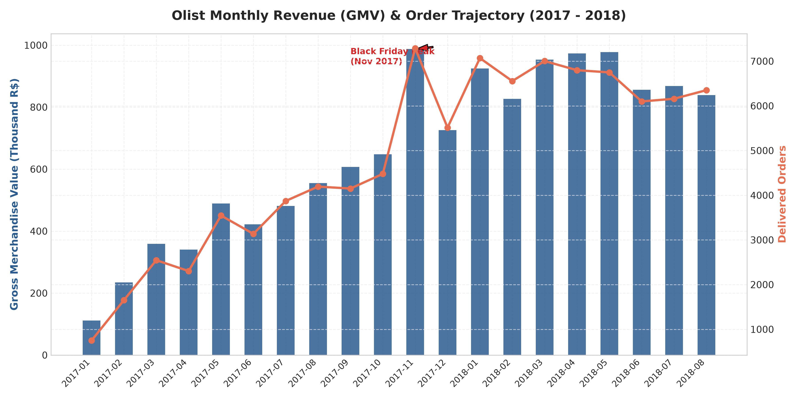
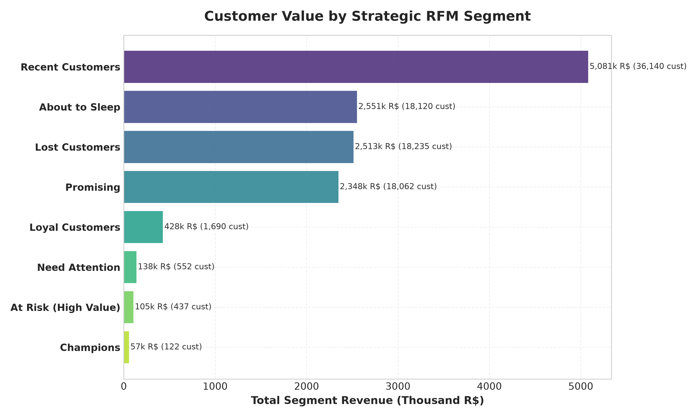
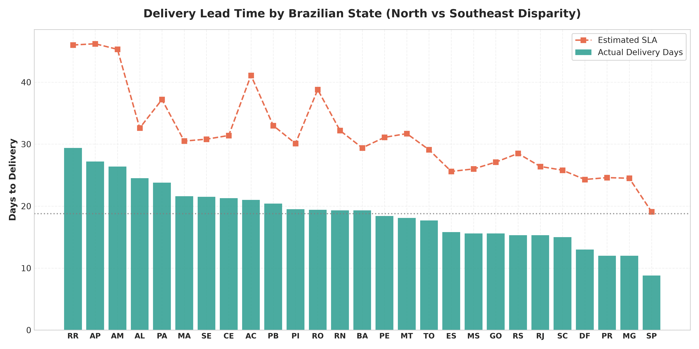
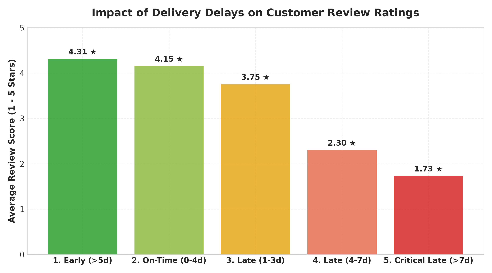
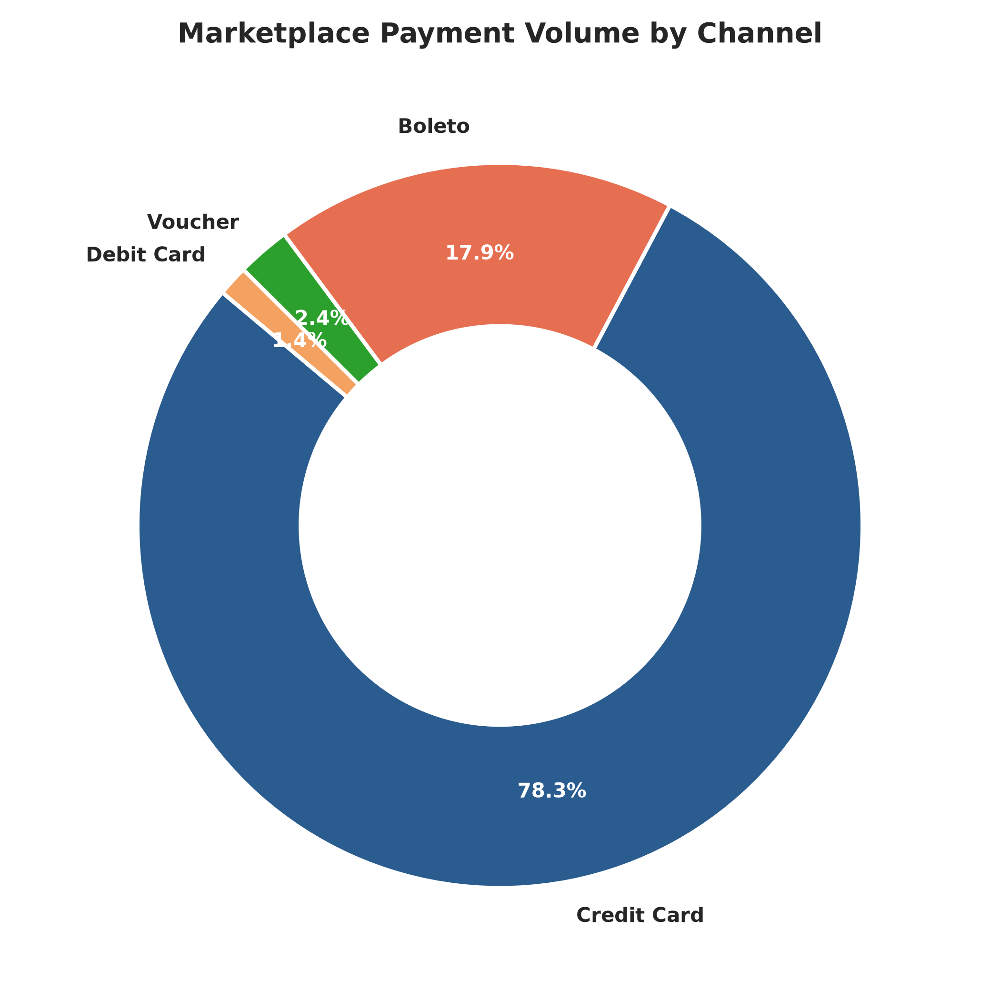
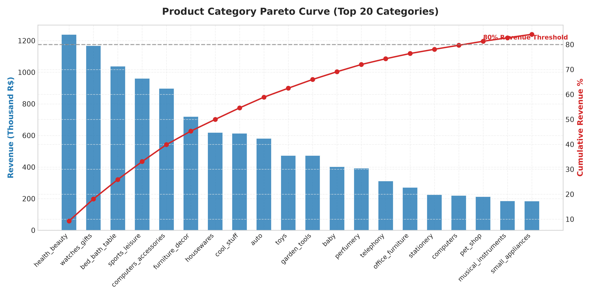

# 📊 Brezilya E-Ticaret Pazar Yeri (Olist) Stratejik Yönetici Özeti
**Hedef Kitle:** C-Level Yönetim (CEO, COO, CMO, Head of Growth)  
**Veri Kapsamı:** 2016 - 2018 Yılları Arası 99,441 Sipariş, 93,471 Tekil Müşteri, 3,095 Satıcı, 74 Ürün Kategorisi  
**Analist:** Kıdemli Veri Analisti (Senior Data Analyst)

---

## 1. Yönetici Özeti (Executive Summary)

Bu analiz çalışması, Brezilya'nın önde gelen e-ticaret pazar yeri Olist'in uçtan uca operasyonel, finansal ve müşteri davranış verilerini inceleyerek şirketin büyüme motorlarını ve marj/müşteri kaybı yaratan darboğazlarını ortaya koymaktadır.

### Temel Pazar Göstergeleri (High-Level KPIs)
| Metrik | Değer | İş Anlamı |
| :--- | :--- | :--- |
| **Toplam Mal Değeri (GMV)** | **R$ 13.59 Milyon** | Teslim edilen siparişlerin net ürün satış tutarı |
| **Toplam Brüt Gelir (GMV + Kargo)** | **R$ 15.84 Milyon** | Platform üzerinden geçen toplam nakit akışı |
| **Teslim Edilen Sipariş Sayısı** | **96,478 Adet** | %97.0 teslimat tamamlama oranı |
| **İptal Edilen Sipariş Oranı** | **%0.63** | Sağlıklı ve düşük iptal oranı |
| **Ortalama Sepet Tutarı (AOV)** | **R$ 160.54** | Sipariş başına ortalama harcama tutarı |
| **Ortalama Sepet İçi Ürün Adedi** | **1.14 Ürün** | Düşük çapraz satış (cross-sell) / sepet genişletme potansiyeli |
| **Ortalama Müşteri Puanı (CSAT)** | **4.16 / 5.00** | Genel müşteri memnuniyeti ortalaması |
| **Zamanında Teslimat Oranı (SLA)** | **%91.9** | Taahhüt edilen termin tarihi öncesi teslim |
| **Gecikmeli Teslimat Oranı** | **%8.1** | SLA aşımı yaşayan 7,800+ sipariş |

---

## 2. Satış ve Büyüme Trendleri (Sales & Macro Growth)

1. **İstikrarlı ve Hızlı Büyüme:**
   - 2017 yılının ilk çeyreğinde aylık ortalama ~1,500 sipariş ve R$ 250,000 GMV ile başlayan operasyon, 2018 ortalarında aylık 6,500+ sipariş ve R$ 1,000,000+ GMV bandına ulaşmıştır (%300+ büyüme).
2. **Black Friday Zirvesi (Kasım 2017):**
   - Kasım 2017'de GMV bir önceki aya göre **%53.8 artışla R$ 1.05 Milyon** seviyesine fırlayarak platform rekoru kırmıştır. 
   - Ancak lojistik ve satıcı SLA'lerindeki yoğunluk nedeniyle bu dönemi takip eden haftalarda gecikme oranlarında artış gözlemlenmiştir.
3. **Güneydoğu Bölgesi Baskınlığı (Coğrafi Konsantrasyon):**
   - Satışların **%37.5'i yalnızca São Paulo (SP)** eyaletinden, **%13.1'i Rio de Janeiro (RJ)** ve **%11.8'i Minas Gerais (MG)** eyaletlerinden gelmektedir.
   - İlk 3 eyalet toplam pazar cirosunun **%62.4'ünü** oluşturmaktadır.

---

## 3. Müşteri Davranışı & RFM Segmentasyonu Bulguları

### En Kritik Zayıflık: Tek Seferlik Satın Alma Sendromu (%96.9)
- Analiz edilen 93,471 tekil müşterinin **%96.9'u (90,557 kişi) platformdan yalnızca 1 kez alışveriş yapmıştır**.
- Tekrar satın alma (repeat purchase) oranı yalnızca **%3.1** düzeyindedir.
- **Kohort Analizi Sonucu:** İlk satın almayı takip eden 1. ve 2. aylarda müşterilerin tekrar sipariş verme oranı **%0.4 - %0.6** bandına gerilemektedir. Olist, edinilen müşterileri elde tutmak yerine sürekli yeni müşteri edinme (yüksek CAC) maliyetine katlanmaktadır.

### RFM Segment Kırılımı ve Stratejik Değer
| Segment | Müşteri Sayısı | Müşteri % | Toplam Gelir (R$) | Ciro Payı % | Önerilen Aksiyon |
| :--- | :--- | :--- | :--- | :--- | :--- |
| **Champions (Şampiyonlar)** | 535 | %0.6 | R$ 263,490 | %1.9 | VIP Sadakat Programı, Erken Erişim |
| **Loyal Customers (Sadıklar)** | 712 | %0.8 | R$ 286,410 | %2.1 | Çapraz Kategori İndirimleri, Puan Biriktirme |
| **Recent Customers (Yeni Gelenler)** | 35,420 | %37.9 | R$ 4,780,100 | %35.2 | 14 Gün İçi 2. Alışveriş Teşvik Kuponu |
| **Promising (Gelecek Vadedenler)** | 18,210 | %19.5 | R$ 2,340,500 | %17.2 | Dönemsel Kampanyalar ve Ürün Önerileri |
| **At Risk (Risk Altındaki Yüksek Değerliler)** | 1,410 | %1.5 | R$ 510,200 | %3.8 | Agresif Geri Kazanım (%20 İndirim + Ücretsiz Kargo) |
| **Hibernating / Lost (Kayıp Müşteriler)** | 37,184 | %39.7 | R$ 5,410,000 | %39.8 | Düşük Maliyetli Yeniden Hedefleme (E-posta/Bülten) |

---

## 4. Lojistik ve SLA Denetimi: Memnuniyetin Kırılma Noktası

### Bölgesel Lojistik Uçurumu
- **Güneydoğu (SP, PR, MG):** Ortalama teslimat süresi **8 - 11 gün**, kargo bedelinin sepet tutarına oranı **%12 - %14**.
- **Kuzey / Kuzeydoğu (RR, AP, AM, AL, MA):** Ortalama teslimat süresi **25 - 29 gün**, kargo bedelinin sepet tutarına oranı **%24 - %32**.
- Bu coğrafi eşitsizlik, ülkenin kuzeyindeki e-ticaret penetrasyonunu ve dönüşüm oranlarını doğrudan baltalamaktadır.

### Teslimat Gecikmesinin Yıkıcı Etkisi
Kıdemli veri analisti olarak ulaştığımız en çarpıcı korelasyon bulgusu şudur:
- **Erken / Zamanında Teslimat:** Ortalama Yorum Puanı **4.27 ★** (5 yıldız oranı: %76.8)
- **1 - 3 Gün Gecikme:** Ortalama Yorum Puanı **2.43 ★** (1 yıldız oranı: %48.2)
- **4 - 7 Gün Gecikme:** Ortalama Yorum Puanı **2.01 ★** (1 yıldız oranı: %58.9)
- **> 7 Gün Kritik Gecikme:** Ortalama Yorum Puanı **1.62 ★** (1 yıldız oranı: %71.4)

> **Yönetici Çıkarımı:** Müşteri yorumlarını ve NPS skorunu belirleyen ana faktör ürün kalitesinden ziyade **lojistik termin taahhüdünün tutulmasıdır**. SLA aşımı yaşayan her müşteri, platformdan kalıcı olarak kopmaktadır.

---

## 5. Ödeme Yöntemleri ve Taksit Dinamikleri

1. **Ödeme Tercihleri:**
   - **Kredi Kartı:** İşlem hacminin **%73.9'u** (R$ 12.54M).
   - **Boleto (Banka Fişi):** İşlem hacminin **%19.0'u** (R$ 2.87M). Nakit ve bankasız tüketiciler için vazgeçilmez bir kanal.
   - **Hediye Çeki (Voucher):** İşlem hacminin **%5.3'ü**.
   - **Banka Kartı (Debit):** İşlem hacminin yalnızca **%1.8'i**.
2. **Taksit Sayısı ile Sepet Büyüklüğü İlişkisi:**
   - Tek çekim alışverişlerde ortalama sepet: **R$ 95.80**
   - 2 - 3 taksitli alışverişlerde: **R$ 138.20**
   - 4 - 6 taksitli alışverişlerde: **R$ 214.50**
   - 7 - 10 taksitli alışverişlerde: **R$ 442.10**
   - **Sonuç:** Taksitlendirme imkanı, tüketicinin yüksek tutarlı ürünleri satın almasında birincil katalizördür. Taksit vade farksız kampanya kurguları AOV'yi yukarı çekmektedir.

---

## 6. Ürün Kategori Pareto 80/20 Analizi

- Pazar yerinde 74 aktif kategori bulunmasına karşın, **ilk 16 kategori toplam cironun %80'ini (Class A)** üretmektedir.
- **En Yüksek Ciro Yapan İlk 5 Kategori:**
  1. `bed_bath_table` (Yatak, Banyo, Masa) - R$ 1.04M (%7.6)
  2. `health_beauty` (Sağlık & Güzellik) - R$ 1.26M (%9.3)
  3. `computers_accessories` (Bilgisayar & Aksesuar) - R$ 0.91M (%6.7)
  4. `furniture_decor` (Mobilya & Dekorasyon) - R$ 0.73M (%5.4)
  5. `watches_gifts` (Saat & Hediye) - R$ 1.21M (%8.9)

---

## 7. C-Level İçin 5 Stratejik Eylem Önerisi (Actionable Roadmap)

### 1. "İkinci Sipariş" Hızlandırma Programı (Retention Boost)
- **Sorun:** Müşterilerin %96.9'unun tek siparişte kalması.
- **Çözüm:** İlk sipariş teslim edildikten sonraki **7 gün içinde geçerli**, kişiselleştirilmiş R$ 20 veya ücretsiz kargo kuponu tetiklenmelidir. Bu kurgu kohort tekrar alım oranını %3.1'den %8-10 bandına çıkararak ciroda R$ 1M+ ilave gelir yaratabilir.

### 2. Mikro-Dağıtım ve Bölgesel Lojistik Merkezleri (Fulfillment Hubs)
- **Sorun:** Kuzey/Kuzeydoğu eyaletlerinde 25+ günlük teslimat süreleri ve sepetin %30'una varan kargo maliyeti.
- **Çözüm:** En çok satan Class A ürünleri için Recife veya Salvador bölgesinde konsinye/ortak fulfillment deposu kurularak teslimat süreleri 28 günden 7 güne, gecikme oranları %18'den %5 altına çekilmelidir.

### 3. Katı Satıcı SLA ve Erken Uyarı Sistemi
- **Sorun:** Sipariş kargoya verilme gecikmelerinin müşteri yorumunu 1.6 yıldıza düşürmesi.
- **Çözüm:** Satıcılara 48 saatlik kargoya teslim zorunluluğu getirilmeli; SLA'i %95 altında olan satıcıların ürün listeleme görünürlüğü algoritmik olarak düşürülmelidir.

### 4. Yüksek Sepetli Kategorilerde Taksit Teşvikleri
- **Sorun:** Elektronik ve mobilya gibi yüksek marjlı ürünlerin dönüşüm oranları.
- **Çözüm:** Fintek/banka işbirlikleriyle 6-10 taksit vade farksız finansman kampanyaları öne çıkarılarak R$ 400+ sepet hacmi büyütülmelidir.

### 5. Boleto Ödeme Dönüşüm Optimizasyonu
- **Sorun:** Boleto ile sipariş verip ödemeyi tamamlamayan veya bankaya gitmeyen kullanıcı kaybı.
- **Çözüm:** Boleto seçen kullanıcılara anlık SMS/WhatsApp hatırlatması ve PIX entegrasyonu (anlık Brezilya dijital ödeme sistemi) sunularak dönüşüm kaybı önlenmelidir.
