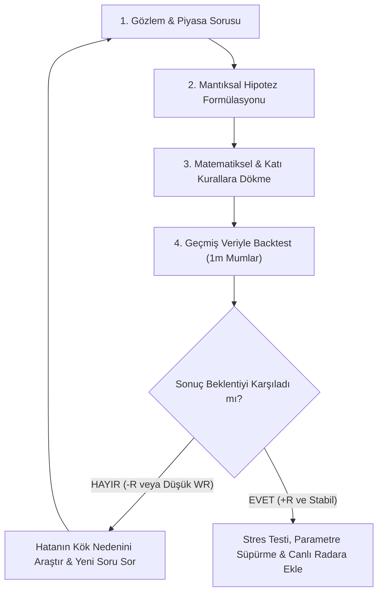

# 🧠 Kantitatif Veri Bilimi, Alım-Satım Felsefesi ve Hipotez Rehberi

Bu belge, finansal piyasalarda **"Geleceği tahmin etme yanılgısı"** ile **"Kantitatif Üstünlük (Edge) ve Veri Bilimi Yaklaşımı"** arasındaki farkı, bilimsel hipotez üretim döngüsünü ve piyasada istatistiksel üstünlük kurmanın temel kurallarını belgeler.

---

## 🎯 1. Temel Felsefe: "Geleceği Bilmek" vs "Asimetrik Risk Yönetimi"

Piyasada yeni başlayanların en büyük yanılgısı, kârlı bir stratejinin geleceği yüksek oranda (%80-%90) bilmesi gerektiği inancıdır. Gerçeklik ise tamamen farklıdır:

### İki Farklı Yaklaşımın Karşılaştırması

| Özellik | Geleneksel / Amatör Yaklaşım | Kantitatif Veri Bilimci Yaklaşımı |
| :--- | :--- | :--- |
| **Temel Amaç** | Hangi koinin yükseleceğini tahmin etmek (Falcılık) | Pozitif beklenen değere (+EV) sahip asimetrik fırsatları bulmak |
| **Başarı Ölçütü** | Yüksek Win Rate (%70-%80 kazanma arzusu) | Net Kasa Getirisi (Toplam R Kazancı, Kâr Faktörü, Sharpe Oranı) |
| **Kayıp Algısı** | Zarar edince sistemi çöpe atma, hayal kırıklığı | Kaybı işin kaçınılmaz işletme maliyeti (-1 R) olarak kabul etme |
| **Giriş Yöntemi** | Yükselen yeşil mumu kovalama (Late Chase / FOMO) | Matematiksel filtreler, likidite seviyeleri ve hacim onayı |
| **Karar Mekanizması** | Hissiyat, sosyal medya tüyoları, indikatör kalabalığı | Milyonlarca barlık geçmiş veride test edilmiş katı kurallar |

> [!IMPORTANT]
> **Kritik İstatistik**:
> 6 aylık filtrelenmiş 1:3 R:R testimizde **178 işlemin 106'sı (%60'ı) STOP olmuş**, yalnızca 41'i (%23'ü) hedefe ulaşmıştır.
> Buna rağmen kasa **+35.88 R NET KÂR** üretmiş ve sermaye **+%36 ile +%42 arasında büyümüştür**.
> Para kazanmak için geleceği %60 bilmek gerekmez; **1 kaybederken 3 kazandığın bir yapıda %25 bilmek bile kasayı katlar.**

---

## 🚨 2. Neden "Yükseleni Tepeden Kovalamak" (Late Chase) Kaybettirir?

Açılıştan sonra rastgele %3 yükselen koine piyasa emriyle bodoslama girmenin filtresiz testte **-202.87 R zarar** ettirmesinin nedeni piyasa mikroyapısıdır:

1. **Sahte Kırılım (Bull Trap / Likidite Avı)**:
   - Kripto piyasasında düşük hacimli bir koinin %3 yükselmesi genellikle piyasa yapıcıların (Market Maker) küçük yatırımcıyı içeri çekmek için oluşturduğu yapay bir fitildir.
   - Küçük yatırımcı yeşil mumu görüp alıma geçtiğinde, büyük oyuncular kâr satışı yapar; fiyat hemen geri çekilerek -%2.2 stopu patlatır.
2. **Gecikmiş Giriş (Late Entry)**:
   - Fiyat %3 yükseldiğinde ilk momentum dalgası zaten tükenmiştir. Tepeden girildiğinde stop mesafesi geniş tutulmak zorunda kalınır.
3. **Çözüm (Akıllı Giriş)**:
   - Fiyat uçtuktan sonra tepeden atlamak yerine; koinin **CVD (Taker Volume Delta)** ile kurumsal alım aldığını teyit etmek veya **VWAP / Açılış seviyesine geri çekilmesini (Pullback/Retest)** bekleyip dar stopla (%0.8) pozisyona girmek.

---

## 🔄 3. Bilimsel Hipotez Üretim Döngüsü (The Quant Loop)

Veri bilimci gibi düşünmek, aşağıdaki 5 adımlı döngüyü sürekli ve disiplinli bir şekilde işletmektir:

### Hipotez Oluşturma Aşamaları:
1. **Gözlem (Observation)**: *"Bazı koinler açılışta çok hacim almasına rağmen hemen çöküyor, bazıları ise gün boyu ralli yapıyor."*
2. **Soru (Research Question)**: *"Acaba bu ayrım günün hangi saatinde kırılım olduğuna ve BTC'nin durumuna mı bağlı?"*
3. **Hipotez (Hypothesis)**: *"Günün ilk 1 saatindeki kırılımlar tuzaktır; ancak Asya seansı oturduktan sonra (01:00 - 04:00 UTC) BTC yeşilken ve kümülatif hacim $\ge$ $10M iken gerçekleşen kırılımların 1:3 R:R başarı oranı %20'nin üzerindedir."*
4. **Test (Empirical Test)**: SQLite veritabanındaki 59 likit koin ve 16 milyon satırlık 1 dakikalık mumlar üzerinde Python ile saniyeler içinde simülasyon.
5. **Karar (Decision)**: Filtresiz -202 R'lık sistem, optimal filtrelerle **+35.88 R kâra** dönüştü. Hipotez doğrulandı.

---

## 🧪 4. Birlikte Test Edebileceğimiz 4 Temel Kantitatif Hipotez

### Hipotez 1: Short Squeeze & Fonlama Oranı (Funding Rate)
- **Finansal Mantık**: Piyasada herkes agresif şekilde short pozisyon açtığında (Fonlama Oranı < -0.05%), piyasa yapıcı yukarı yönlü ani bir likidasyon iğnesi atarak short'ları patlatır.
- **Test Edilecek Kural**: Fonlama oranı aşırı negatif olan ve son 1 saatte Açık Pozisyonu (OI) artan koinlerde hacim patlaması gelirse long yönlü başarı oranı nedir?

### Hipotez 2: Retest / Pullback (Dar Stoplu Giriş)
- **Finansal Mantık**: %3 yükselen koine tepeden girmek yerine, ilk tepkinin ardından VWAP'a veya gün açılışına geri çekilip tutunmasını beklemek.
- **Test Edilecek Kural**: Stop mesafesi %2.2 yerine %0.8'e indiğinde R:R oranı 1:4 veya 1:5'e çıkar mı? Net R getirisi nasıl etkilenir?

### Hipotez 3: Hafta Sonu vs Hafta İçi Rejim Farkı
- **Finansal Mantık**: Cumartesi ve Pazar günleri geleneksel kurumlar ve bankalar kapalı olduğu için tahtalar sığlaşır, manipülatif sahte kırılımlar artar.
- **Test Edilecek Kural**: Hafta içi açılan kırılımların kâr faktörü ile hafta sonu açılanların kâr faktörü arasındaki fark nedir?

### Hipotez 4: Sektör Rotasyonu ve Öncü Koin Etkisi
- **Finansal Mantık**: Belirli bir anlatı (AI, Meme, DeFi, L1) başladığında, sektörün amiral gemisi (örn. WLD veya ENA) ilk hareketi yapar; ardından arkasından gelen ikinci koin onu takip eder.
- **Test Edilecek Kural**: Sektör lideri %5 yaptığında, aynı sektördeki ikincil koine girilirse gecikmeli getiri (lagged alpha) yakalanabilir mi?

---

## ⚠️ 5. Veri Bilimcinin En Tehlikeli Düşmanı: "Overfitting" (Aşırı Uyum)

Veriye bilgisayarla 10.000 rastgele kombinasyon sorulursa, tamamen tesadüf eseri son 6 ayda %90 kazandırmış kurallar mutlaka bulunabilir (Örn: *"Perşembe günleri saat 15:42'de adı D ile başlayan koini al"*). Buna **P-Hacking** veya **Veri Madenciliği Yanılgısı (Data Dredging)** denir.

### Overfitting'den Kaçınmanın 3 Kuralı:
1. **Ekonomik / Piyasa Mantığı Şarttır**:
   Her kuralın insan psikolojisi, piyasa yapıcı dinamikleri veya kurumsal likidite ile açıklanabilir bir temeli olmalıdır.
2. **Az Parametre, Yüksek Sağlamlık**:
   2-3 temel ve güçlü filtre (Piyasa Trendi, Zaman Penceresi, Kurumsal Hacim) 15 tane karmaşık göstergeden her zaman daha dayanıklıdır.
3. **Out-of-Sample (Örneklem Dışı) Doğrulama**:
   Bir dönemde test edilip başarılı bulunan kural, tamamen farklı bir piyasa periyodunda (örneğin sert bir ayı sezonunda) test edilerek dayanıklılığı ölçülmelidir.

---

## 📌 Sonuç ve Yol Haritası

- AI ve veri bilimi, geleceği söyleyen bir falcı değil; **piyasa gürültüsünü filtreleyen, duygulardan arındırılmış, matematiksel üstünlüğü tespit eden objektif bir araştırma ortağıdır.**
- Akla gelen her yeni fikir veya piyasa gözlemi, duygusal olarak parayla denenmeden önce bu laboratuvarda Python ve geçmiş verilerle test edilecek, yalnızca pozitif beklenen değere (+EV) sahip olanlar stratejiye dönüştürülecektir.
